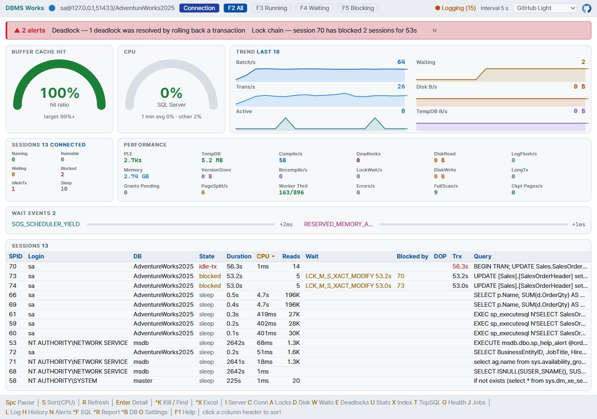
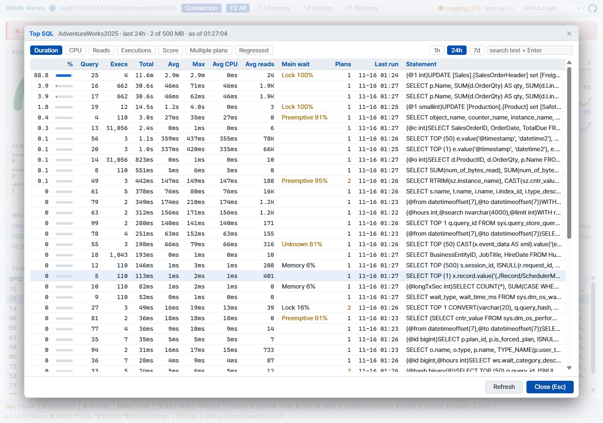
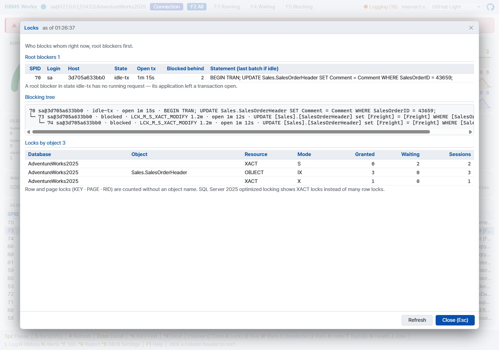
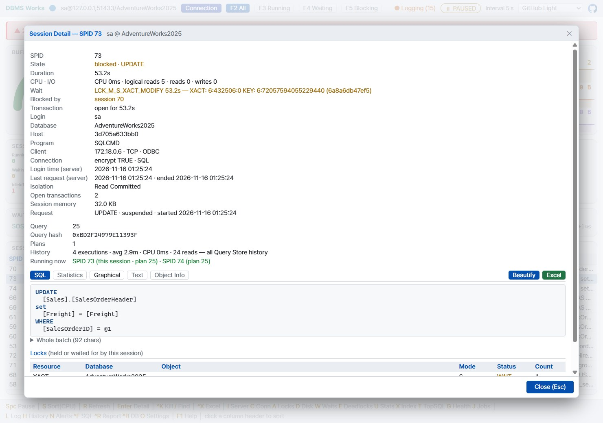
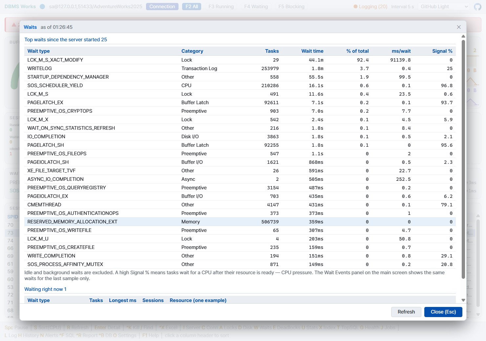
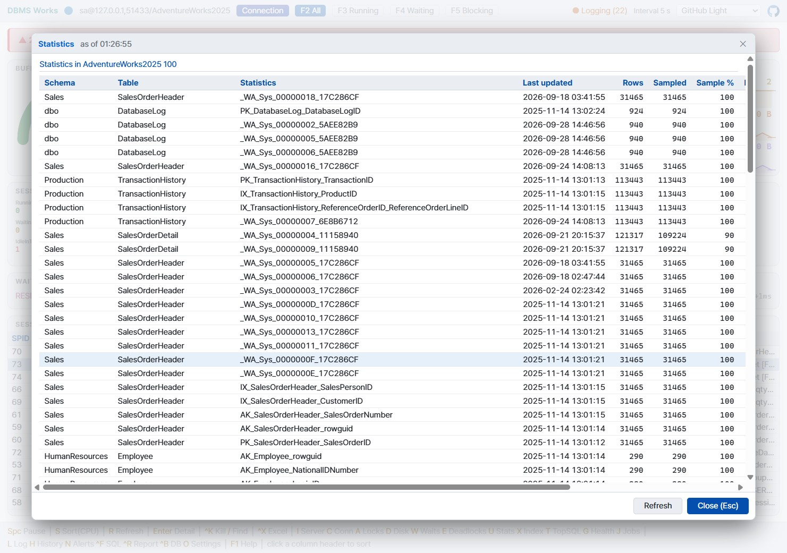
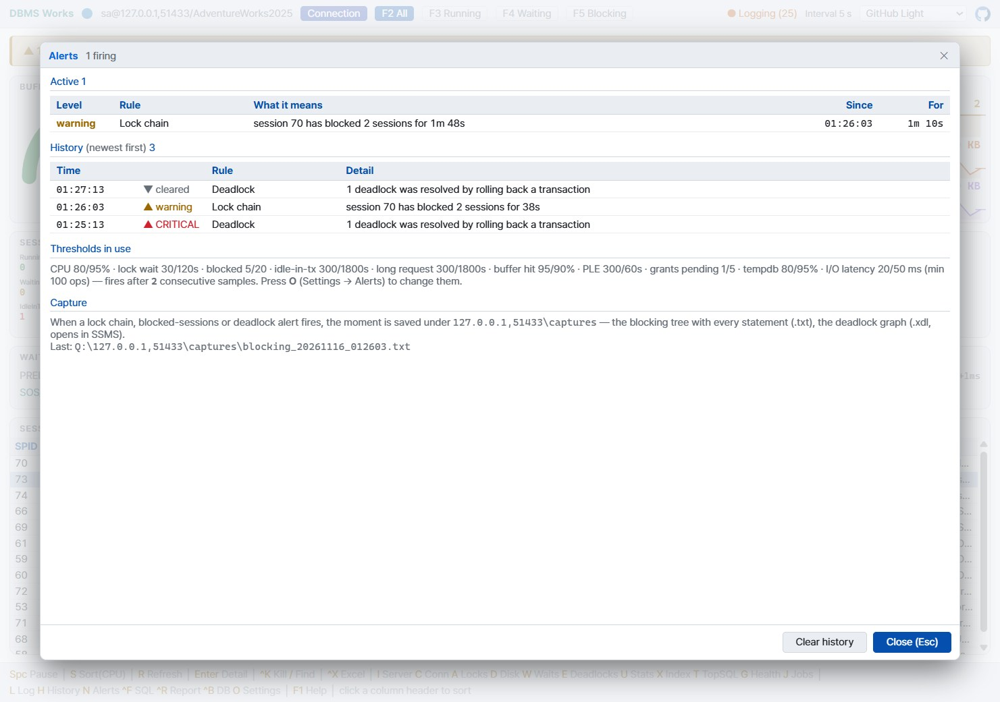
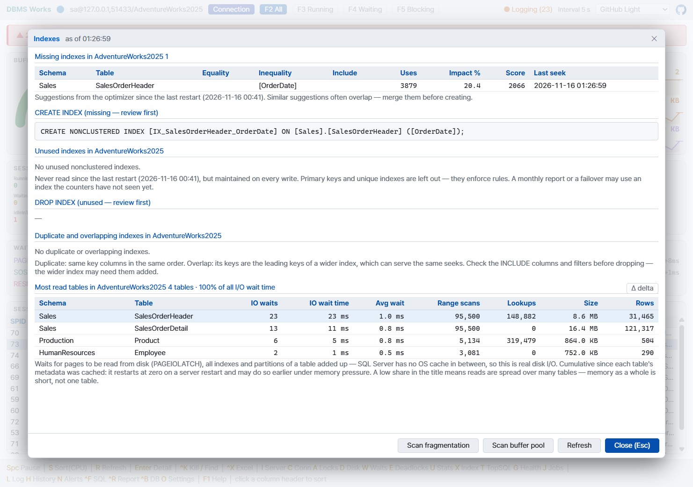
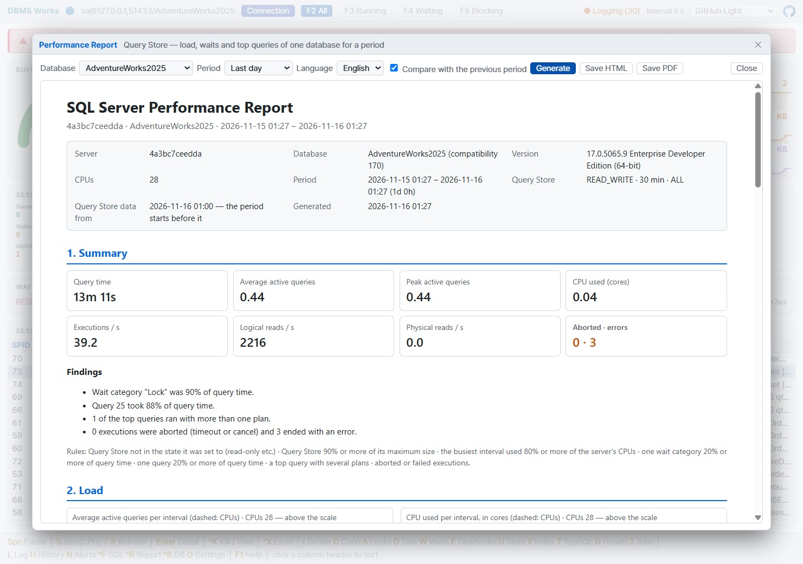
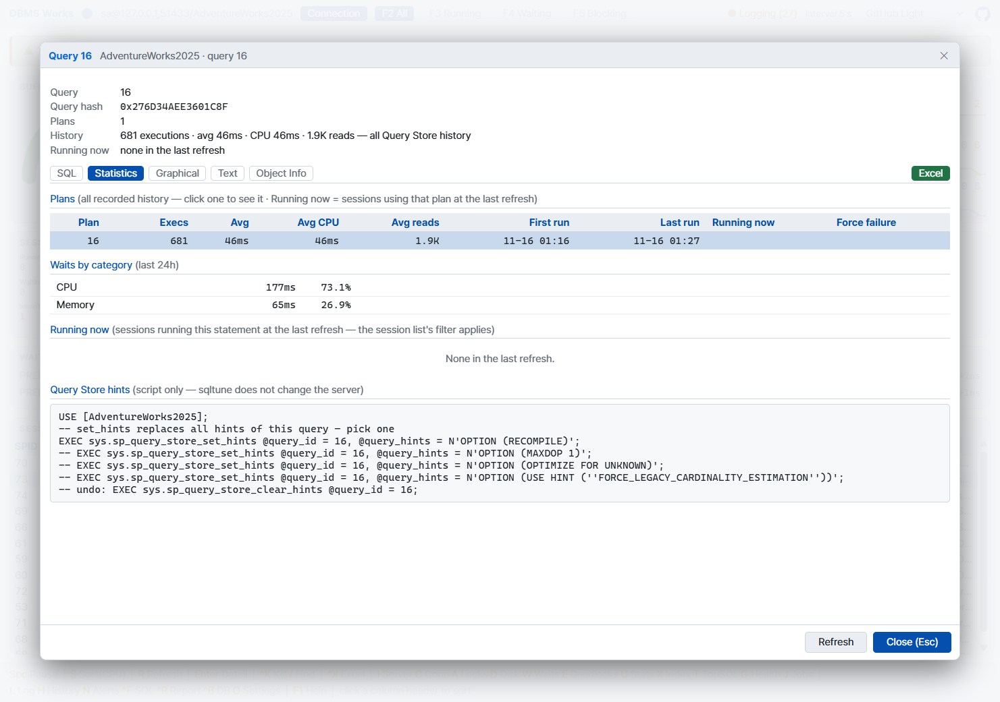

# sqltune — a real-time SQL Server monitor (free)


**[Download the latest release](https://github.com/Doni-Kim/sqltune-release/releases/latest)** ·
[한국어 설명](README.ko.md) · [Manual (Korean, HTML)](sqltune.html)

sqltune is a desktop monitor for SQL Server. One window, one executable, nothing to install on the server —
everything is read from DMVs, Query Store and the system catalog. It only reads: the one thing that changes
the server is killing a session, and only when you confirm it.
Free to use, no strings attached.

## Screenshots

| Live dashboard | Top SQL (Query Store) |
|---|---|
|  |  |

| Lock chains | Session detail |
|---|---|
|  |  |

| Waits | Statistics |
|---|---|
|  |  |

| Alerts | Index diagnostics |
|---|---|
|  |  |

| Performance report | Query Store hints |
|---|---|
|  |  |

The screenshots show a throwaway test server (Docker) with the AdventureWorks sample database.

## Install

- Unzip, keep the folder together, and run `sqltune.exe` (single-file publish).
- No .NET install needed — the runtime is inside the executable.
- The connection window opens first: add a server with **+ New**, fill in server, port, sign-in and database, and press
  **Connect**. Connections and settings are kept in `sqltune.db` next to the executable (passwords encrypted).
- Coming from 2.x? Overwrite `sqltune.exe` — the connection json files next to it are brought in on the first start (below).

## What it does

- **Live dashboard** — two gauges (buffer cache hit ratio, SQL Server CPU), six trends (batches and transactions per second and active requests on the left;
  waiting requests, disk bytes and tempdb bytes per second on the right), session counts by state, and eighteen Performance cells in six columns:
  PLE / memory / memory grants pending, tempdb / version store / page splits, compiles / recompiles / worker threads, deadlocks / lock waits / errors,
  disk reads / disk writes (with latency) / full scans, log flushes / long-open transactions / checkpoint pages — then top waits and the session list.
  Rates always cover the last sample, not the time since the server started; a value the server did not return shows `n/a`, not 0.
  SQL Server CPU is a share of the CPUs SQL Server may use: when affinity or an edition limit gives it only some of the
  host's CPUs (say 4 of 8), 100% means all of those are busy, and the gauge also shows "4 of 8 CPUs" and the share of the whole host.
- **Lock chains that find the real root** — including sessions that left a transaction open and went idle
  (`idle-tx`), the usual root blocker that request-only views miss. `F5` shows blockers together with the
  sessions they block.
- **Session detail** (`Enter`) — full statement and batch, the live execution plan with actual row counts so far
  (or the cached plan) — **drawn like SSMS** (boxes and arrows, the same operator properties when you point at a box) or as text — and locks held. `Ctrl+K` kills the session (it checks the login time first, so a reused
  session number is never killed by mistake); `Ctrl+X` exports the session to Excel — grouped sheets with the plan picture and
  an operator table (readable without another tool, plus a `.sqlplan` file), locks, and the size, indexes and statistics of the tables in its plan.
- **Panels** — Server (`I`), Connections (`C`), Locks (`A`), Disk (`D`), Waits (`W`),
  Deadlocks (`E`, from `system_health`, the latest one spelled out), Statistics (`U`, with an UPDATE STATISTICS
  script), Indexes (`X`: missing with CREATE, unused with DROP, duplicate and overlapping, fragmentation on demand).
- **Top SQL** (`T`) — from Query Store: by duration, CPU, reads, executions or a combined score, over 1 h / 24 h /
  7 days; statements with several plans; regressed queries (at least twice as slow as the week before);
  text search; click a column header to re-sort what is on screen; plan history per query with a force-plan script (shown, never run).
  The detail draws each plan and has **Object Info** — every table the plan reads with its columns, indexes and statistics,
  the columns in its predicates marked and `CONVERT_IMPLICIT` on a column flagged (read from Query Store, nothing is run again).
  `Ctrl+F` (Find SQL) opens that detail straight from a Query Store `query_id` or the `query_hash` shown in the session detail.
- **SQL tab** — the statement is the first tab of the detail (`[SQL] [Statistics] [Graphical] [Text] [Object Info]`), and a one-line statement is laid out by clause. Only spaces and line breaks outside quotes change, never a character; `[Beautify]` switches to the original and back.
- **One SQL window** (2.5) — the session detail, Top SQL and Find SQL open the same window: a summary with the sessions running the statement now (and which plan each uses), `[Statistics]` with the Query Store plan history and waits — or the plan cache when Query Store has no record — and `[Excel]` in each. From a session, Query Store is looked up in the session's own database.
- **Performance report** (`Ctrl+R`, 2.10) — one database's Query Store for the last 1, 7 or 30 days as one HTML or PDF file, in English or Korean:
  summary with automatic findings, load per interval, wait categories, the top 20 queries and the Query Store settings,
  and (2.11) the same numbers next to the previous period of the same length.
- **Query Store hints** (2.10, SQL Server 2022+) — the `[Statistics]` tab shows the hints set on a query and a `sp_query_store_set_hints` script (shown, never run).
- **Health Check** (`G`) — 10 categories (server configuration, performance, database settings, indexes,
  statistics, tempdb, files, backups, Agent jobs, log) with a score, a grade and what to fix first; Excel export.
  MAXDOP is judged per NUMA node, PLE by buffer pool size, backups by the server's own clock.
- **Alerts** — 12 rules: CPU (of the CPUs SQL Server may use), lock chains, blocked requests, idle in transaction, long requests, buffer cache hit,
  page life expectancy, memory grants pending, tempdb usage, disk read / write latency, deadlocks —
  with your own thresholds (0 turns a level off).
- **History** — press `L` to log every sample into a local SQLite file, then `H` to look back.
  - Ranges: 1 hour / 6 hours / 24 hours / 1 week / 1 month / all.
  - Every value of the main screen can be picked — 35 metrics in four rows, one per panel. Byte values pick their unit (B/s to GB/s) per range,
    and a value that was not recorded is left empty rather than drawn as 0.
  - Old rows are trimmed automatically (30 days of metrics, 7 days of sessions by default; change it with `O`).
- **Excel export** — built on ClosedXML, so the `.xlsx` is written even without Excel installed.
- **12 themes** — six light, six dark, GitHub Light by default; pick one from the top bar. Reconnects by itself when the connection drops.
- **New in 2.1** — Jobs popup (`J`): SQL Server Agent jobs running now, failed steps with their error text, last result
  and next run of every job. Windows authentication (a checkbox in the connection dialog, or `"windowsAuth": true`).
  Top SQL shows the main wait of each query.
- **Find** — `/` filters the session list by text.
- **When an alert fires** — the blocking tree and statements (`.txt`) or the deadlock graph (`.xdl`) are saved under `captures\`,
  and a Critical alert flashes the taskbar and shows a Windows notification when the window is not in front.
- In History, click a point in time to see the sessions that were logged at that moment.
- **Most read tables** (Indexes, `X`) — which tables waited for disk reads (PAGEIOLATCH), with their share of all I/O
  wait time and a `Δ delta` mode; **Scan buffer pool** shows what sits in memory right now, by table. Both scan buttons
  warn before they run; their time limits are `indexes.fragmentationTimeoutSec` / `indexes.bufferPoolTimeoutSec`.
- **System stored procedures** — the second `F1` tab finds the server's system stored procedures (master and msdb —
  1,600+ on SQL Server 2025) as you type, with their parameters read from the server, so the list always matches its
  version. About 700 have a one-line description and 169 of the most used a sample to copy — built in, so no internet is
  needed. sqltune never runs them.
- **DBCC commands** — the same tab lists 35 DBCC commands (type `dbcc`) — all 32 in Microsoft's reference, in its four groups, plus `MEMORYSTATUS`, `LOGINFO` and `PAGE`: `SQLPERF(LOGSPACE)`, `OPENTRAN`, `INPUTBUFFER`,
  `SHOW_STATISTICS`, `CHECKDB`, `CHECKIDENT`, `SHRINKFILE`, `FREEPROCCACHE`, `TRACEON` … with arguments, the permission
  each needs and a sample to copy; deprecated and undocumented ones are marked.
- **Connection window** (3.0) — saved connections on the left (most recently used first), the selected one on the right.
  **Test** connects, shows the server version and disconnects without saving; **Connect** saves only after it connects.
- **Top bar** (3.0) — the dot before the address is blue while collecting (click it to disconnect) and red while reconnecting
  or disconnected (click it to connect now). **Connection** switches to another server without closing the window, and the
  GitHub icon opens this page.
- **Settings screen** — `O` changes the collection interval (3–60 s, 5 by default), log retention, the Indexes scan time
  limits, Excel, alert thresholds and which sessions `L` logs. Values are checked, saved for the current connection (Excel
  is shared by all connections) and applied at once.
- **Server not answering at startup** — after a second a small window shows whom sqltune is connecting to and for how
  long, with Cancel to fix the connection, instead of an empty screen for 30 seconds.
- `Ctrl+B` switches the database used by the database-level panels. Press `F1` for the keyboard shortcuts, and again for
  the System Procedures & DBCC tab.

The bundled `sqltune.html` is the full manual with screenshots (in Korean).

## Requirements and limits

- **Windows only.** The UI is web-based (Blazor Hybrid), so it does not run standalone on Linux or macOS.
- **SQL Server 2019 or later** — on-premises, VM or Managed Instance. Developed and checked against SQL Server 2025.
- **Azure SQL Database is not supported** — sqltune says so in the connection dialog.
- **Top SQL needs Query Store** in the database you look at (on by default for new databases since SQL Server 2022).
  When it is off, the panel shows the statement that turns it on.
- The code is obfuscated with ConfuserEx — a free tool, so do not expect strong protection.

## A dedicated monitoring account

Checked on SQL Server 2025: with these grants every panel and the Health Check show the same as with `sa`.

```sql
USE master;
CREATE LOGIN sqltune WITH PASSWORD = '...';
GRANT VIEW SERVER STATE    TO sqltune;   -- dashboard, sessions, waits, locks, deadlocks, plans
GRANT VIEW ANY DEFINITION  TO sqltune;   -- Disk: files and volumes of every database
GRANT ALTER ANY CONNECTION TO sqltune;   -- optional: Ctrl+K (kill)

-- In each database you look at with Ctrl+B (Top SQL, Indexes, Statistics, Health Check)
USE YourDatabase;
CREATE USER sqltune FOR LOGIN sqltune;
GRANT VIEW DATABASE STATE TO sqltune;           -- Query Store, index usage, log space
GRANT VIEW DEFINITION     TO sqltune;           -- index and statistics metadata
ALTER ROLE db_datareader ADD MEMBER sqltune;    -- optional: statistics — see below

-- Health Check: backups and Agent jobs
USE msdb;
CREATE USER sqltune FOR LOGIN sqltune;
GRANT SELECT  ON dbo.backupset      TO sqltune;
GRANT SELECT  ON dbo.sysjobs        TO sqltune;
GRANT SELECT  ON dbo.sysjobhistory  TO sqltune;
GRANT EXECUTE ON dbo.agent_datetime TO sqltune;
```

- `sys.dm_db_stats_properties` only returns statistics of tables the login may read, so without
  `db_datareader` the Statistics panel and the Statistics category of the Health Check come back empty.
  Everything else works without it.
- Without `VIEW ANY DEFINITION` the Disk panel shows no files or volumes.
- `SQLAgentReaderRole` is not enough for the Agent check — it covers the Agent procedures, not the job tables.
- When a grant is missing, sqltune says which one on the panel instead of showing an empty list.

## WebView2 runtime

sqltune draws its window with the Microsoft Edge WebView2 runtime. When it is missing, sqltune says so at startup and shows where to get it
(up to 2.6 the window opened but stayed blank).

- **Windows 11** — built into the OS, always present.
- **Windows 10** — shipped through Windows Update since 2021, so it is there on most machines.
  A PC that has not been updated in a long time, or a special edition such as LTSC, may not have it.
- **Windows Server (2016/2019/2022)** — often not included; install it separately.

Install Microsoft's "Evergreen Standalone Installer"
(`MicrosoftEdgeWebView2RuntimeInstallerX64.exe`) from
https://developer.microsoft.com/microsoft-edge/webview2/

## If something breaks

Errors are written to `sqltune.log` next to the executable (the file only appears when something went wrong).

- **Bugs and questions** — open an [issue](https://github.com/Doni-Kim/sqltune-release/issues).
  Please do not attach the log there: it holds no passwords, but it can contain server addresses and SQL text.
- **The log file**, or anything you would rather not post in public — mail it to **doniikim@gmail.com**.

## Built with

- .NET 11.0 (x64), C# 15, Blazor Hybrid
- Microsoft.Data.SqlClient · Microsoft.Data.Sqlite · ClosedXML · Microsoft.Web.WebView2 · Microsoft.AspNetCore.Components.WebView.WindowsForms
- Copyright notices and license texts of these bundled components: [THIRD-PARTY-NOTICES.txt](THIRD-PARTY-NOTICES.txt) (also inside the zip)
- The one-line descriptions of system stored procedures in F1 come from the Microsoft SQL Server documentation
  ([MicrosoftDocs/sql-docs](https://github.com/MicrosoftDocs/sql-docs), © Microsoft, CC BY 4.0) — details in THIRD-PARTY-NOTICES.txt.

## Connections and settings (`sqltune.db`, 3.0)

Everything sqltune keeps lives in `sqltune.db` next to `sqltune.exe`: the connections, each connection's settings (interval,
alerts, log retention, the Indexes scan time limits, log filter) and the window position and theme. Settings are changed
only in `O`, so there is no file to break by hand. To update sqltune, overwrite `sqltune.exe`; deleting `sqltune.db` starts
from scratch. It holds the encrypted passwords — do not hand it to others.

- A named instance goes into **Server** as `HOST\INSTANCE`, with **Port** empty (found through SQL Browser).
- **Sign in**: SQL authentication, or Windows authentication — sqltune signs in as the Windows account that runs it and
  stores no password.
- **Database** is where the database-level panels start (empty = `master`); `Ctrl+B` switches it. The session list is always server-wide.
- **Encrypt**: `mandatory` (default) / `optional` / `strict`. **Certificate** accepts a self-signed certificate (`strict` always verifies).
- Servers sqltune cannot watch (SQL Server below 2019, Azure SQL Database, a login without VIEW SERVER STATE) are refused
  in the connection window, with the reason.
- Only one sqltune runs per folder. Switch servers with **Connection** on the top bar, or use one folder per server to
  watch several at the same time.
- **Coming from 2.x** — overwrite `sqltune.exe` in the old folder. On the first start the connection json files next to it
  (`sqltune.json`, `sqltuneDB1.json`, `prod.json` …) are read once, one connection per file, together with their settings
  (`encrypt`, `trustServerCertificate` and `windowsAuth` too); plain passwords are encrypted. The templates of the 2.3 – 2.11
  packages that were never filled in (password still `<password>`) are skipped. The json files are neither changed nor
  deleted — delete them yourself once you have checked (safer if they held plain passwords). A broken file is skipped, and
  the connection window says which line is wrong.

## Terms

Free to use, at work or at home. Please do not redistribute the binary or reverse-engineer it.
The source is not published.

sqltune bundles third-party components, including Microsoft components (such as the SQL Server network library
Microsoft.Data.SqlClient.SNI). Each is provided under its own license terms, reproduced in full in
[THIRD-PARTY-NOTICES.txt](THIRD-PARTY-NOTICES.txt) (also inside the zip); by using sqltune you also accept those terms.

## Contact

DBMS Works — **doniikim@gmail.com**

Also available for Oracle → PostgreSQL / MySQL migration and database performance tuning work.
